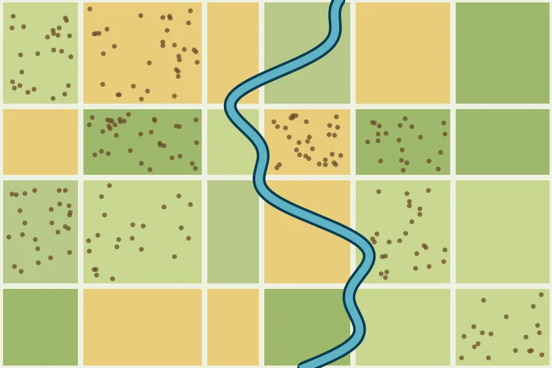
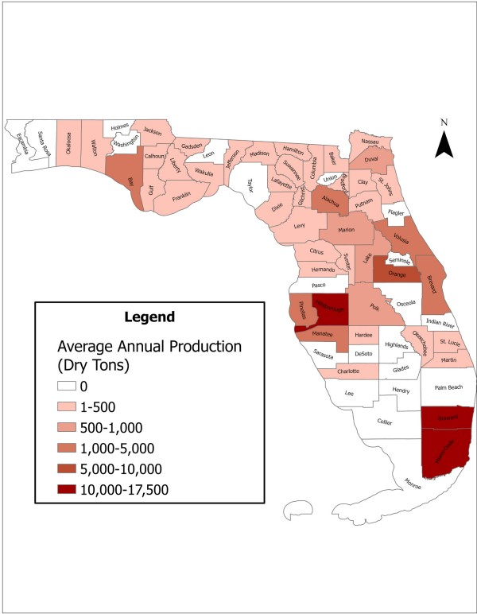
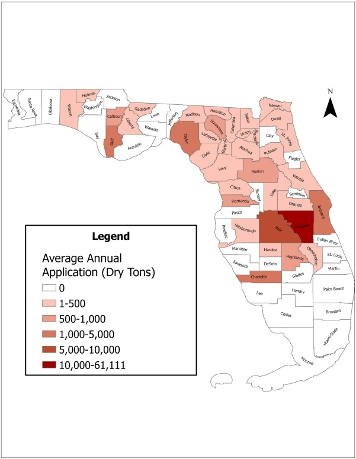
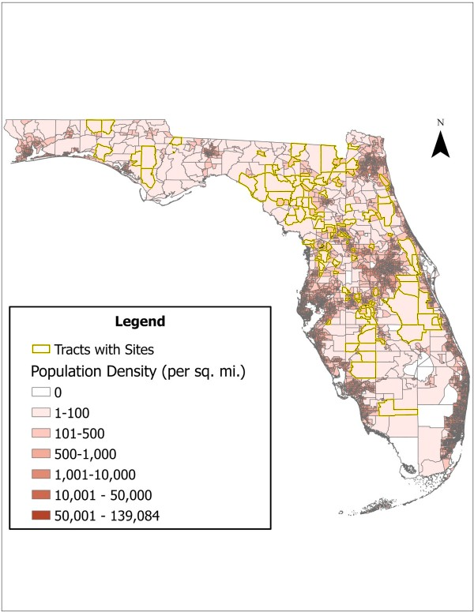
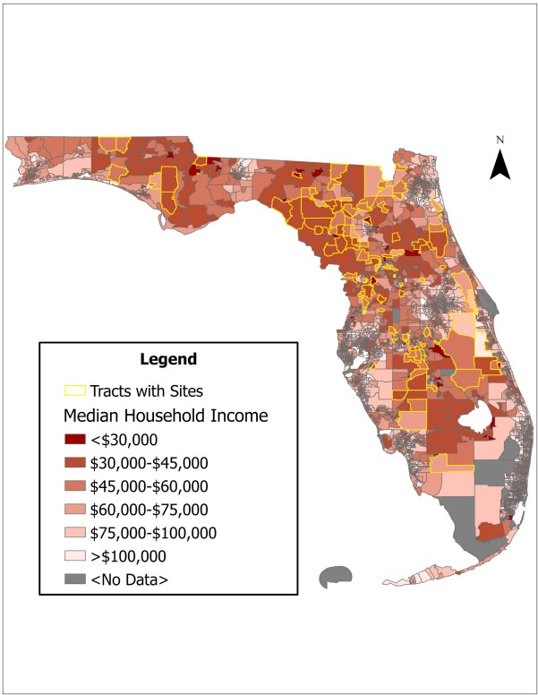
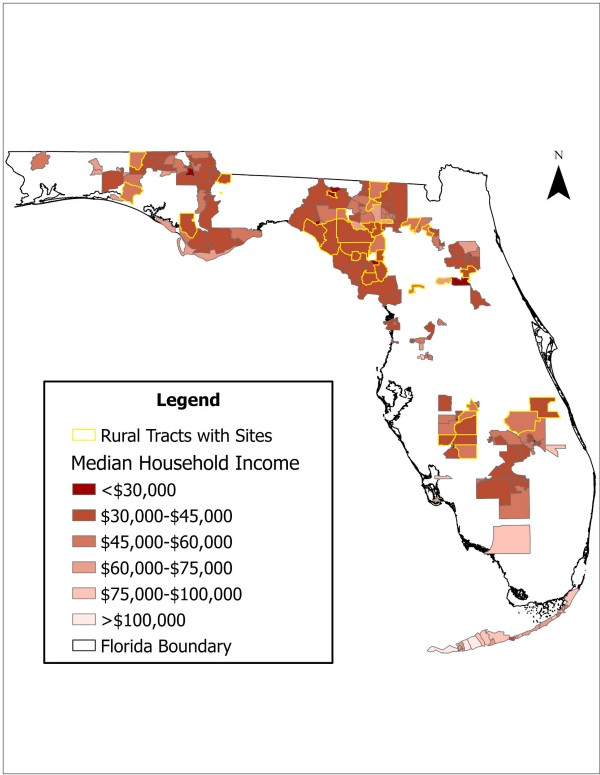

{.banner fig-alt="Warm-toned map with community points of different sizes"}

My dissertation examines how planning processes and policy framing shape biosolids governance in Florida, with a focus on urban–rural distribution and environmental justice. It traces how biosolids policies are developed, implemented, and contested across multiple scales of governance, and links planning theory and environmental justice to regional waste management.

```{=html}
<ul class="tags c-ej"><li>Discourse analysis</li><li>Interviews</li><li>GIS spatial analysis</li><li>Mixed methods</li></ul>
```

## Biosolids in Florida

{.banner fig-alt="Farm parcels with scattered brown dots beside a blue river"}

Biosolids are the treated solids left over from wastewater treatment. In Florida, much of this material is spread on land as fertilizer, often far from the cities that produce it. That raises questions about water quality, rural communities, and who decides.

::: {.feature}
### Biosolids in Florida: An Assessment of Management and Impacts

1000 Friends of Florida, 2025. My role: GIS analysis, spatial assessment, policy analysis, and co-authorship.

[[Read the report (PDF)](https://1000fof.org/wp-content/uploads/2025/06/1000-Friends-Final-Biosolids-Report-_updated.pdf) [Watch the webinar](https://1000fof.org/past-webinars/land-application-of-biosolids-in-florida-challenges-opportunities-and-equitable-solutions/) [Explore the StoryMap](https://storymaps.arcgis.com/stories/746272aacff74e63b70e10c7a1827557)]{.links}
:::

### Biosolids Maps

Where Florida's biosolids are produced compared with where they end up, and who lives in the places that receive them. Use the arrows or thumbnails to flip through them, and click a map to see it full size.

```{=html}
<div class="map-carousel" aria-roledescription="carousel" aria-label="Biosolids maps">
  <div class="mc-stage">
    <button type="button" class="mc-arrow mc-prev" aria-label="Previous map">&#8249;</button>
    <div class="mc-track" tabindex="0">
    <figure class="mc-slide" role="group" aria-roledescription="slide" aria-label="1 of 6: Production">
      <a href="assets/maps/biosolids-production-by-county.jpg" class="lightbox" data-gallery="biosolids-maps" title="Where biosolids are produced: average annual production by county, in dry tons."></a>
      <figcaption><span class="mc-count">1 / 6</span> Where biosolids are produced: average annual production by county, in dry tons.</figcaption>
    </figure>
    <figure class="mc-slide" role="group" aria-roledescription="slide" aria-label="2 of 6: Land application">
      <a href="assets/maps/biosolids-application-by-county.jpg" class="lightbox" data-gallery="biosolids-maps" title="Where biosolids are applied to land: average annual application by county, in dry tons."></a>
      <figcaption><span class="mc-count">2 / 6</span> Where biosolids are applied to land: average annual application by county, in dry tons.</figcaption>
    </figure>
    <figure class="mc-slide" role="group" aria-roledescription="slide" aria-label="3 of 6: Urban & rural tracts">
      <a href="assets/maps/urban-rural-tracts-sites.jpg" class="lightbox" data-gallery="biosolids-maps" title="Rural and urban census tracts, with tracts that contain sites outlined."></a>
      <figcaption><span class="mc-count">3 / 6</span> Rural and urban census tracts, with tracts that contain sites outlined.</figcaption>
    </figure>
    <figure class="mc-slide" role="group" aria-roledescription="slide" aria-label="4 of 6: Population density">
      <a href="assets/maps/population-density-sites.jpg" class="lightbox" data-gallery="biosolids-maps" title="Population density by census tract (people per square mile), with tracts that contain sites outlined."></a>
      <figcaption><span class="mc-count">4 / 6</span> Population density by census tract (people per square mile), with tracts that contain sites outlined.</figcaption>
    </figure>
    <figure class="mc-slide" role="group" aria-roledescription="slide" aria-label="5 of 6: Income, all tracts">
      <a href="assets/maps/median-income-all-tracts.jpg" class="lightbox" data-gallery="biosolids-maps" title="Median household income by census tract, with tracts that contain sites outlined."></a>
      <figcaption><span class="mc-count">5 / 6</span> Median household income by census tract, with tracts that contain sites outlined.</figcaption>
    </figure>
    <figure class="mc-slide" role="group" aria-roledescription="slide" aria-label="6 of 6: Income, rural tracts">
      <a href="assets/maps/median-income-rural-tracts.jpg" class="lightbox" data-gallery="biosolids-maps" title="Median household income in rural tracts, with rural tracts that contain sites outlined."></a>
      <figcaption><span class="mc-count">6 / 6</span> Median household income in rural tracts, with rural tracts that contain sites outlined.</figcaption>
    </figure>
    </div>
    <button type="button" class="mc-arrow mc-next" aria-label="Next map">&#8250;</button>
  </div>
  <div class="mc-thumbs">
    <button type="button" class="mc-thumb" data-i="0" aria-label="Show map 1: Production"><span>Production</span></button>
    <button type="button" class="mc-thumb" data-i="1" aria-label="Show map 2: Land application"><span>Land application</span></button>
    <button type="button" class="mc-thumb" data-i="2" aria-label="Show map 3: Urban & rural tracts"><span>Urban & rural tracts</span></button>
    <button type="button" class="mc-thumb" data-i="3" aria-label="Show map 4: Population density"><span>Population density</span></button>
    <button type="button" class="mc-thumb" data-i="4" aria-label="Show map 5: Income, all tracts"><span>Income, all tracts</span></button>
    <button type="button" class="mc-thumb" data-i="5" aria-label="Show map 6: Income, rural tracts"><span>Income, rural tracts</span></button>
  </div>
</div>
<script>
(function () {
  var root = document.currentScript.previousElementSibling;
  var track = root.querySelector(".mc-track");
  var slides = root.querySelectorAll(".mc-slide");
  var thumbs = root.querySelectorAll(".mc-thumb");
  var n = slides.length, cur = 0;
  function go(i, smooth) {
    cur = (i + n) % n;
    track.scrollTo({ left: slides[cur].offsetLeft - track.offsetLeft, behavior: smooth === false ? "auto" : "smooth" });
    mark();
  }
  function mark() { thumbs.forEach(function (t, k) { t.classList.toggle("on", k === cur); t.setAttribute("aria-current", k === cur ? "true" : "false"); }); }
  root.querySelector(".mc-prev").addEventListener("click", function () { go(cur - 1); });
  root.querySelector(".mc-next").addEventListener("click", function () { go(cur + 1); });
  thumbs.forEach(function (t) { t.addEventListener("click", function () { go(+t.dataset.i); }); });
  track.addEventListener("keydown", function (e) {
    if (e.key === "ArrowRight") { go(cur + 1); e.preventDefault(); }
    if (e.key === "ArrowLeft") { go(cur - 1); e.preventDefault(); }
  });
  var t;
  track.addEventListener("scroll", function () {
    clearTimeout(t);
    t = setTimeout(function () { cur = Math.round(track.scrollLeft / track.clientWidth); mark(); }, 80);
  }, { passive: true });
  mark();
})();
</script>
```

### In the News

```{=html}
<a class="news-card" href="https://www.wuft.org/environment/2025-12-29/urban-waste-rural-consequences">
  <div class="thumb">
    
  </div>
  <div class="body">
    <p class="kind">WUFT News, December 29, 2025</p>
    <h4>Urban Waste, Rural Consequences</h4>
    <p class="by">By Alanna F. Robbert. Features an interview with me on why rural communities are left out of biosolids planning.</p>
    <blockquote>"It's mostly a planning issue that rural residents aren't included in the planning process."</blockquote>
    <p class="credit">Photo: Alanna Robbert/WUFT News</p>
  </div>
</a>
```

## Key literature

- Jones, C. C. (2011). Environmental justice in rural context: Land-application of biosolids in central Virginia. *Environmental Justice*, 4(1), 1–15. [Link](https://www.liebertpub.com/doi/abs/10.1089/env.2009.0034)
- Lowman, A., et al. (2013). Land application of treated sewage sludge: Community health and environmental justice. *Environmental Health Perspectives*, 121(5), 537–542. [Link](https://pmc.ncbi.nlm.nih.gov/articles/PMC3673187/)
- Walker, C., Mason, S., & Bednar, D. (2018). Sustainable development and environmental injustice in rural Ontario, Canada: Cases of wind energy and biosolid processing. *Journal of Rural and Community Development*, 13(2). [Link](https://journals.brandonu.ca/jrcd/article/view/1506)
