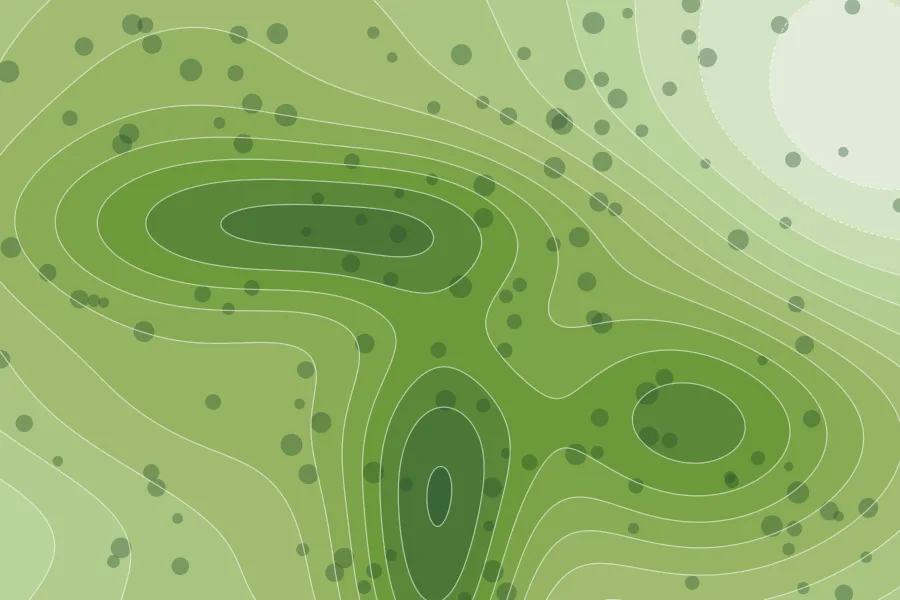
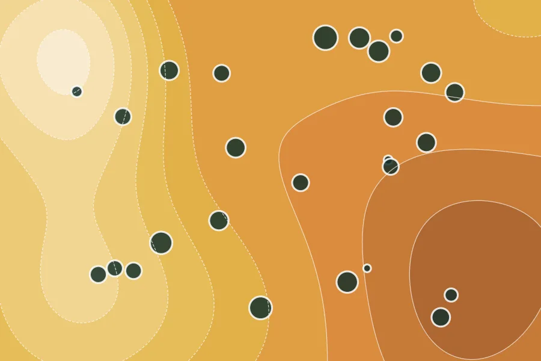
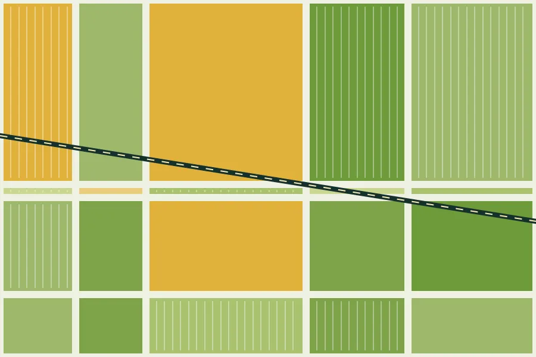
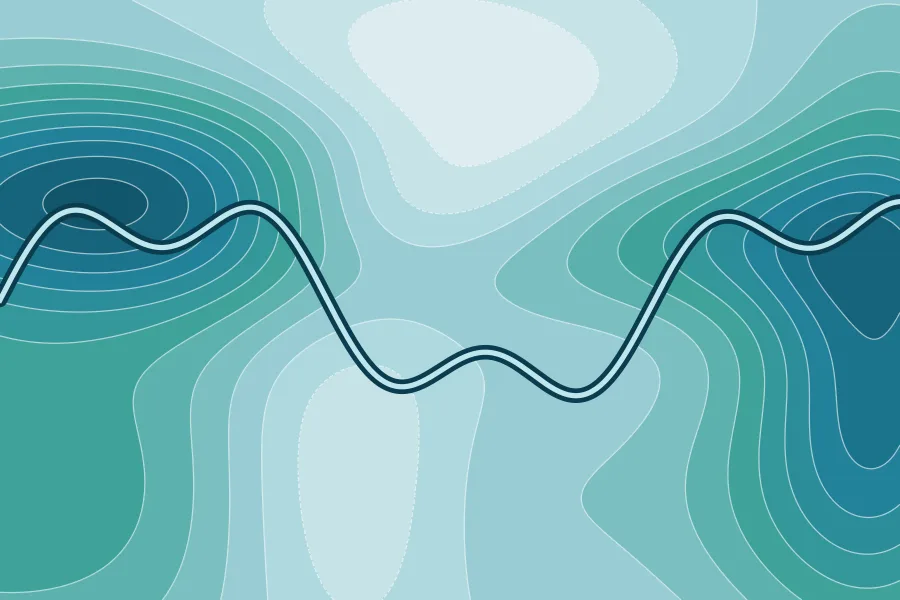
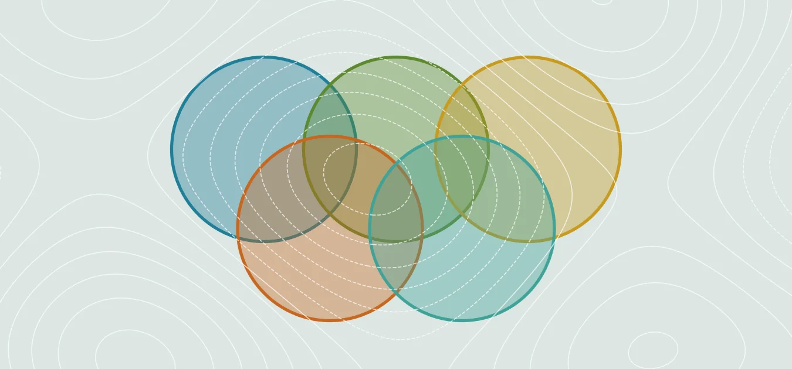

```{=html}
<section class="hero">
  <h1 class="name">Elio<br>Fernandez</h1>
  <p class="line">Interdisciplinary research on Sustainability, Environmental Justice, Urban–Rural Planning, and Water Quality in Florida.</p>
  <div class="actions">
    <a class="primary" href="#what-i-study">Explore the research</a>
    <a href="maps.html">Maps</a>
    <a href="blog.html">Blog</a>
  </div>
  <p class="coords">Tallahassee, Florida, 30.44° N 84.28° W</p>
</section>
```

## What I Study

```{=html}
<div class="theme-carousel" aria-roledescription="carousel" aria-label="Research areas">
  <button type="button" class="mc-arrow tc-prev" aria-label="Previous research area">&#8249;</button>
  <div class="themes tc-track" tabindex="0">
    <a class="theme c-sus" href="sustainability.html">
    
    <h3>Sustainability</h3>
    <p>Keeping Florida livable for the long run.</p>
    </a>
    <a class="theme c-ej" href="environmental-justice.html">
    
    <h3>Environmental Justice</h3>
    <p>Who carries the burdens, and who gets a say.</p>
    </a>
    <a class="theme c-rural" href="urban-rural-planning.html">
    
    <h3>Urban–Rural Planning</h3>
    <p>How city growth and policy reach rural Florida.</p>
    </a>
    <a class="theme c-water" href="water-quality.html">
    
    <h3>Water Quality</h3>
    <p>Springs, rivers, and the aquifer beneath them.</p>
    </a>
    <a class="theme c-inter" href="interdisciplinary.html">
    
    <h3>Interdisciplinary &amp; Transdisciplinary Research</h3>
    <p>Social and quantitative sciences, working on the same problems.</p>
    </a>
  </div>
  <button type="button" class="mc-arrow tc-next" aria-label="Next research area">&#8250;</button>
  <div class="tc-dots"><button type="button" class="tc-dot" data-i="0" aria-label="Go to 1 of 5"></button><button type="button" class="tc-dot" data-i="1" aria-label="Go to 2 of 5"></button><button type="button" class="tc-dot" data-i="2" aria-label="Go to 3 of 5"></button><button type="button" class="tc-dot" data-i="3" aria-label="Go to 4 of 5"></button><button type="button" class="tc-dot" data-i="4" aria-label="Go to 5 of 5"></button></div>
</div>
<script>
(function () {
  var root = document.currentScript.previousElementSibling;
  var track = root.querySelector(".tc-track");
  var cards = track.children, dots = root.querySelectorAll(".tc-dot");
  var n = cards.length, cur = 0;
  function perView() { return Math.max(1, Math.round(track.clientWidth / cards[0].offsetWidth)); }
  function last() { return Math.max(0, n - perView()); }
  function go(i) {
    var L = last();
    cur = i > L ? 0 : (i < 0 ? L : i);
    track.scrollTo({ left: cards[cur].offsetLeft - cards[0].offsetLeft, behavior: "smooth" });
    mark();
  }
  function mark() {
    var pv = perView();
    dots.forEach(function (d, k) { d.classList.toggle("on", k >= cur && k < cur + pv); });
  }
  root.querySelector(".tc-prev").addEventListener("click", function () { go(cur - 1); });
  root.querySelector(".tc-next").addEventListener("click", function () { go(cur + 1); });
  dots.forEach(function (d) { d.addEventListener("click", function () { go(Math.min(+d.dataset.i, last())); }); });
  track.addEventListener("keydown", function (e) {
    if (e.key === "ArrowRight") { go(cur + 1); e.preventDefault(); }
    if (e.key === "ArrowLeft") { go(cur - 1); e.preventDefault(); }
  });
  var t;
  track.addEventListener("scroll", function () {
    clearTimeout(t);
    t = setTimeout(function () {
      var x = track.scrollLeft, best = 0, bd = 1e9;
      for (var k = 0; k < n; k++) { var d = Math.abs(cards[k].offsetLeft - cards[0].offsetLeft - x); if (d < bd) { bd = d; best = k; } }
      cur = best; mark();
    }, 90);
  }, { passive: true });
  window.addEventListener("resize", mark);
  mark();
})();
</script>
```

