## Publications

```{=html}
<article class="pub">
  <div class="pub-head">
    <p class="kind">Journal article, Journal of Rural Studies, August 2026</p>
    <h3><a href="https://doi.org/10.1016/j.jrurstud.2026.104324">Urban-Rural Transfer and Distributive Environmental Justice in Biosolids Land Application: A Geographic Information Systems (GIS) Analysis of Florida</a></h3>
    <p class="cite">Fernandez, E. (2026). <em>Journal of Rural Studies</em>, 126, 104324. <a href="https://doi.org/10.1016/j.jrurstud.2026.104324">doi.org/10.1016/j.jrurstud.2026.104324</a></p>
  </div>
  <div class="pub-feature">
    <a class="pub-thumb lightbox" href="assets/maps/urban-rural-tracts-sites.jpg" data-gallery="pub-article" title="Rural and urban census tracts, with tracts that contain sites outlined.">
      
    </a>
    <div>
      <p class="hl-title">Highlights</p>
      <ul class="highlights">
        <li>Urban-rural transfer produces environmental inequality.</li>
        <li>Biosolids sites are disproportionately located in rural areas.</li>
        <li>Income is a stronger predictor of exposure than race.</li>
        <li>Results reveal within-rural socioeconomic stratification.</li>
      </ul>
      <p class="links"><a href="https://doi.org/10.1016/j.jrurstud.2026.104324">Read the article</a> <a href="dissertation.html#biosolids-maps">See the maps</a></p>
    </div>
  </div>
</article>
```


```{=html}
<article class="pub">
  <div class="pub-head">
    <p class="kind">Policy report, 1000 Friends of Florida, 2025</p>
    <h3><a href="https://1000fof.org/wp-content/uploads/2025/06/1000-Friends-Final-Biosolids-Report-_updated.pdf">Biosolids in Florida: An Assessment of Management and Impacts</a></h3>
    <p class="cite">Co-author. GIS analysis, spatial assessment, and policy analysis.</p>
  </div>
  <div class="viewer doc">
    <iframe src="https://docs.google.com/viewer?url=https%3A%2F%2F1000fof.org%2Fwp-content%2Fuploads%2F2025%2F06%2F1000-Friends-Final-Biosolids-Report-_updated.pdf&amp;embedded=true" title="Biosolids in Florida report" loading="lazy"></iframe>
  </div>
  <p class="links"><a href="https://1000fof.org/wp-content/uploads/2025/06/1000-Friends-Final-Biosolids-Report-_updated.pdf">Open the report (PDF)</a> <a href="https://1000fof.org/past-webinars/land-application-of-biosolids-in-florida-challenges-opportunities-and-equitable-solutions/">Watch the webinar</a> <a href="dissertation.html#biosolids-in-florida">Project page</a></p>
</article>
```

## Talks

```{=html}
<article class="pub">
  <div class="pub-head">
    <p class="kind">Florida Planning Conference, APA Florida, Daytona Beach, 2025</p>
    <h3>Environmental Justice Concerns in Urban–Rural Planning for Biosolids: A Literature Review</h3>
    <p class="cite">Warren, H. &amp; Fernandez, E. (2025).</p>
  </div>
  <div class="viewer slides">
    <iframe src="https://drive.google.com/file/d/1EOxz4BVsizSJvwPIvk6U-3UVeIFfhsHS/preview" title="Slides: Environmental Justice Concerns in Urban–Rural Planning for Biosolids" loading="lazy" allowfullscreen></iframe>
  </div>
  <p class="links"><a href="https://docs.google.com/presentation/d/1EOxz4BVsizSJvwPIvk6U-3UVeIFfhsHS/present">Open slides full screen</a></p>
</article>

<article class="pub">
  <div class="pub-head">
    <p class="kind">LEEF Mini Conference, Vero Beach, 2024</p>
    <h3>Interdisciplinary Social Sciences in Environmental Education</h3>
    <p class="cite">Fernandez, E. (2024).</p>
  </div>
  <div class="viewer slides">
    <iframe src="https://drive.google.com/file/d/1drX3N20pPSXsY3pCFME32kKAvYoDE--1/preview" title="Slides: Interdisciplinary Social Sciences in Environmental Education" loading="lazy" allowfullscreen></iframe>
  </div>
  <p class="links"><a href="https://docs.google.com/presentation/d/1drX3N20pPSXsY3pCFME32kKAvYoDE--1/present">Open slides full screen</a></p>
</article>
```

## Course Projects

```{=html}
<article class="pub">
  <div class="pub-head">
    <p class="kind">Class project, Florida State University</p>
    <h3>Principal Component Analysis: Pine Island Sound Monitoring Station</h3>
    <p class="cite">Fernandez, E. A principal component analysis of 12 water quality variables (2009–2018) from a Lee County monitoring station in Pine Island Sound, near the mouth of the Caloosahatchee River.</p>
  </div>
<div class="map-carousel slide-carousel" aria-roledescription="carousel" aria-label="PCA presentation slides">
  <div class="mc-stage">
    <button type="button" class="mc-arrow mc-prev" aria-label="Previous slide">&#8249;</button>
    <div class="mc-track" tabindex="0">
    <figure class="mc-slide" role="group" aria-roledescription="slide" aria-label="1 of 11: Title">
      <a href="assets/talks/pca/slide-01.webp" class="lightbox" data-gallery="pca-slides" title="Slide 1: Title">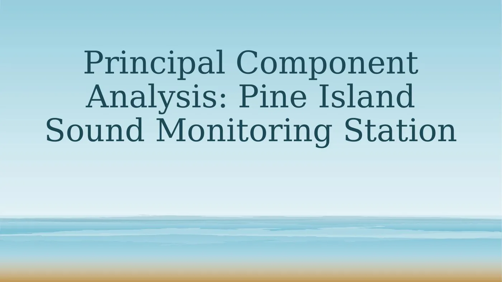</a>
      <figcaption><span class="mc-count">1 / 11</span> Title</figcaption>
    </figure>
    <figure class="mc-slide" role="group" aria-roledescription="slide" aria-label="2 of 11: Pine Island Sound">
      <a href="assets/talks/pca/slide-02.webp" class="lightbox" data-gallery="pca-slides" title="Slide 2: Pine Island Sound">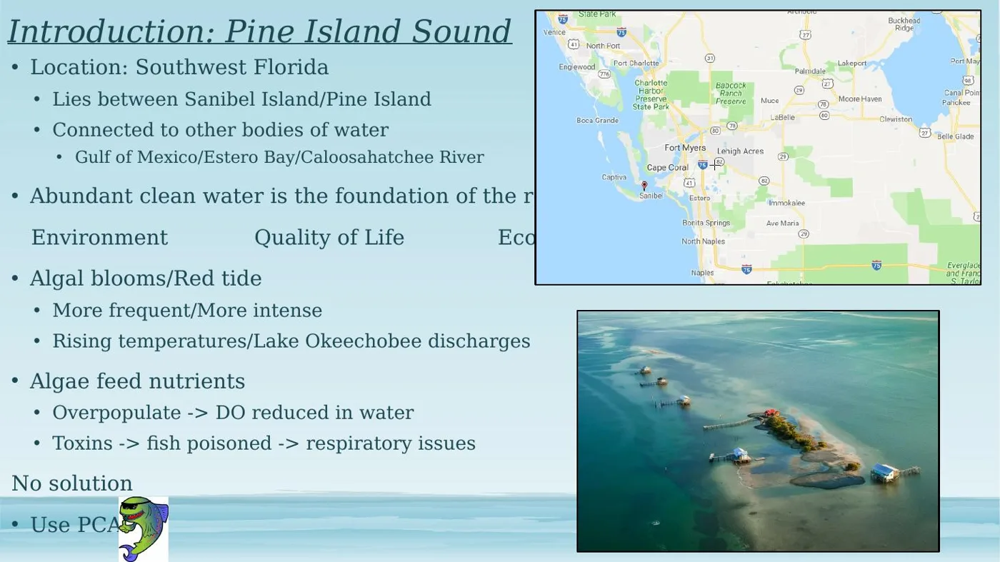</a>
      <figcaption><span class="mc-count">2 / 11</span> Pine Island Sound</figcaption>
    </figure>
    <figure class="mc-slide" role="group" aria-roledescription="slide" aria-label="3 of 11: What is PCA?">
      <a href="assets/talks/pca/slide-03.webp" class="lightbox" data-gallery="pca-slides" title="Slide 3: What is PCA?">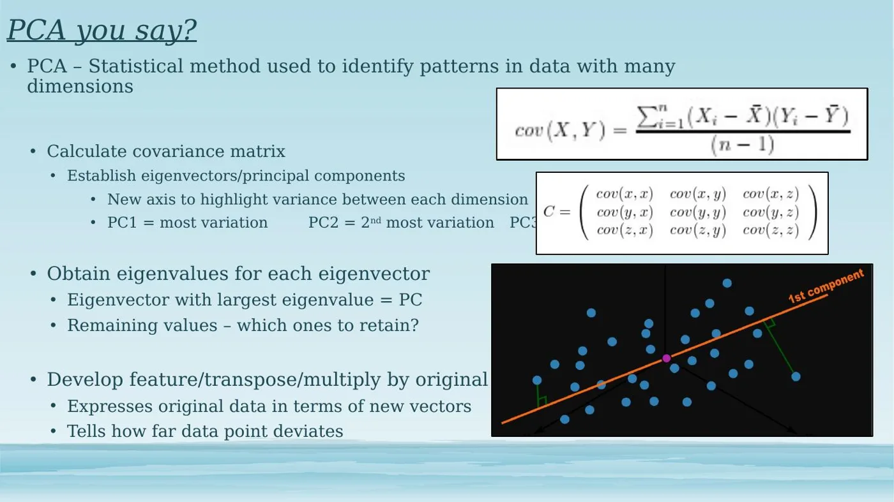</a>
      <figcaption><span class="mc-count">3 / 11</span> What is PCA?</figcaption>
    </figure>
    <figure class="mc-slide" role="group" aria-roledescription="slide" aria-label="4 of 11: Data & methods">
      <a href="assets/talks/pca/slide-04.webp" class="lightbox" data-gallery="pca-slides" title="Slide 4: Data & methods">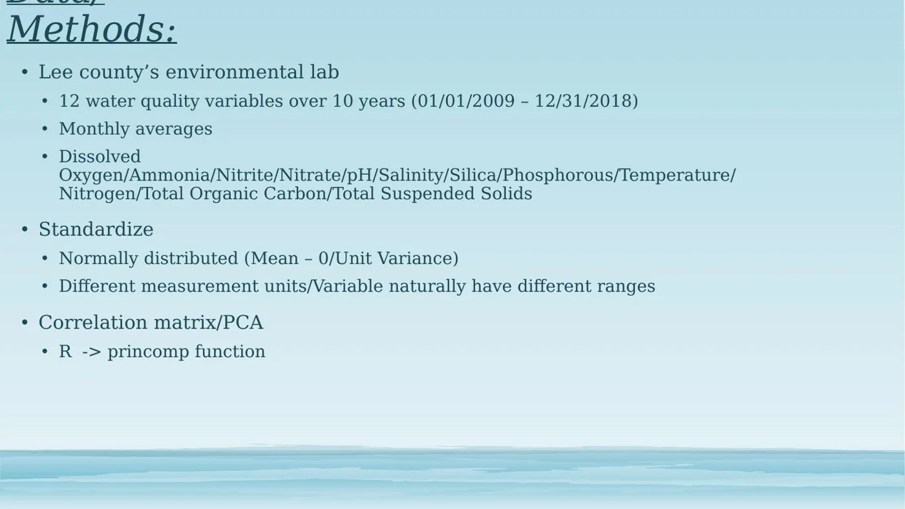</a>
      <figcaption><span class="mc-count">4 / 11</span> Data & methods</figcaption>
    </figure>
    <figure class="mc-slide" role="group" aria-roledescription="slide" aria-label="5 of 11: Reducing dimensionality">
      <a href="assets/talks/pca/slide-05.webp" class="lightbox" data-gallery="pca-slides" title="Slide 5: Reducing dimensionality">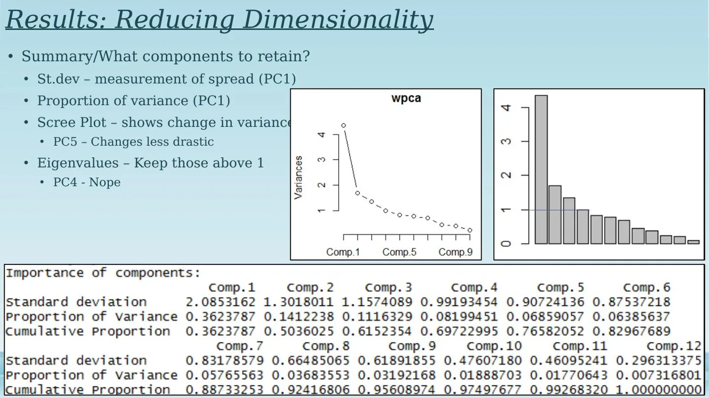</a>
      <figcaption><span class="mc-count">5 / 11</span> Reducing dimensionality</figcaption>
    </figure>
    <figure class="mc-slide" role="group" aria-roledescription="slide" aria-label="6 of 11: Loadings">
      <a href="assets/talks/pca/slide-06.webp" class="lightbox" data-gallery="pca-slides" title="Slide 6: Loadings">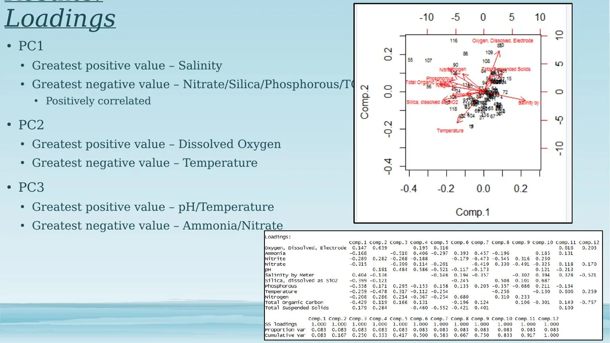</a>
      <figcaption><span class="mc-count">6 / 11</span> Loadings</figcaption>
    </figure>
    <figure class="mc-slide" role="group" aria-roledescription="slide" aria-label="7 of 11: Correlation matrix">
      <a href="assets/talks/pca/slide-07.webp" class="lightbox" data-gallery="pca-slides" title="Slide 7: Correlation matrix">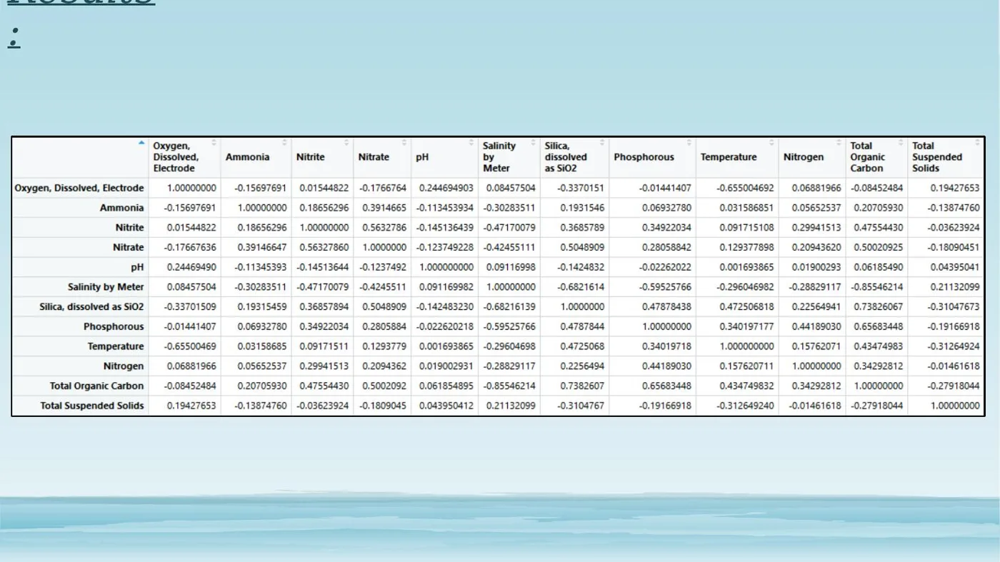</a>
      <figcaption><span class="mc-count">7 / 11</span> Correlation matrix</figcaption>
    </figure>
    <figure class="mc-slide" role="group" aria-roledescription="slide" aria-label="8 of 11: PC1: Salinity & nutrients">
      <a href="assets/talks/pca/slide-08.webp" class="lightbox" data-gallery="pca-slides" title="Slide 8: PC1: Salinity & nutrients">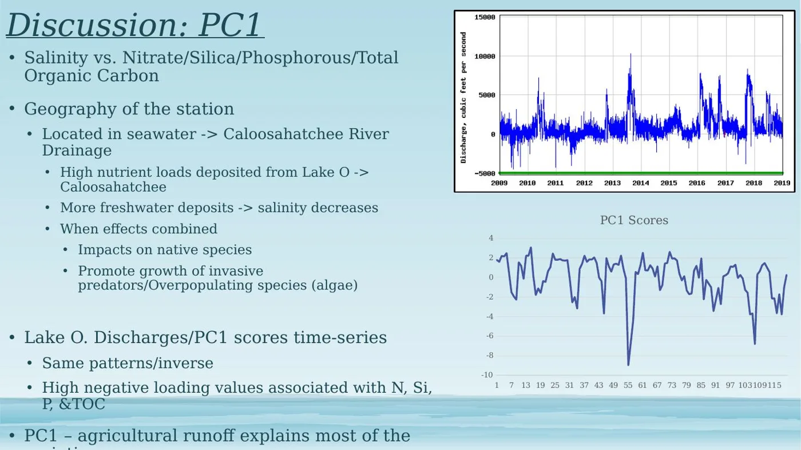</a>
      <figcaption><span class="mc-count">8 / 11</span> PC1: Salinity & nutrients</figcaption>
    </figure>
    <figure class="mc-slide" role="group" aria-roledescription="slide" aria-label="9 of 11: PC2: Oxygen & temperature">
      <a href="assets/talks/pca/slide-09.webp" class="lightbox" data-gallery="pca-slides" title="Slide 9: PC2: Oxygen & temperature">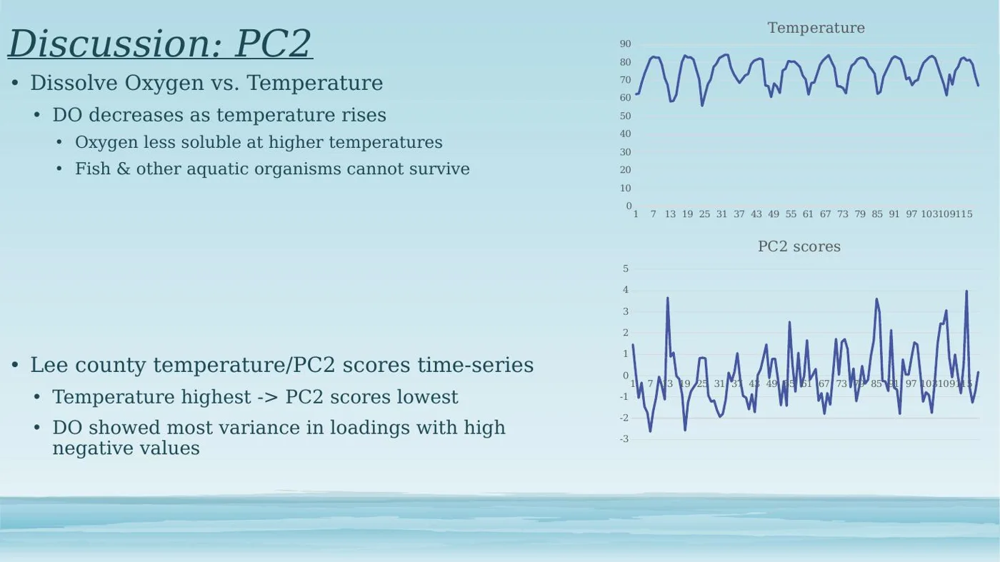</a>
      <figcaption><span class="mc-count">9 / 11</span> PC2: Oxygen & temperature</figcaption>
    </figure>
    <figure class="mc-slide" role="group" aria-roledescription="slide" aria-label="10 of 11: PC3: pH & ammonia">
      <a href="assets/talks/pca/slide-10.webp" class="lightbox" data-gallery="pca-slides" title="Slide 10: PC3: pH & ammonia">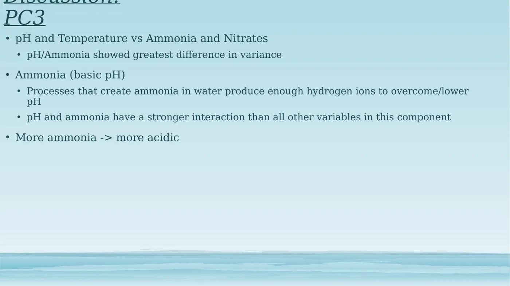</a>
      <figcaption><span class="mc-count">10 / 11</span> PC3: pH & ammonia</figcaption>
    </figure>
    <figure class="mc-slide" role="group" aria-roledescription="slide" aria-label="11 of 11: Conclusion">
      <a href="assets/talks/pca/slide-11.webp" class="lightbox" data-gallery="pca-slides" title="Slide 11: Conclusion">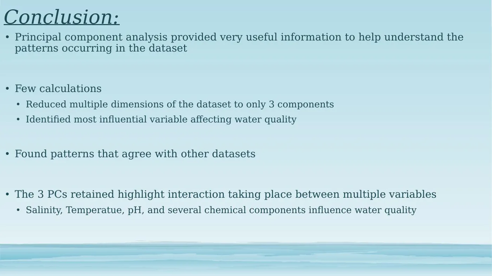</a>
      <figcaption><span class="mc-count">11 / 11</span> Conclusion</figcaption>
    </figure>
    </div>
    <button type="button" class="mc-arrow mc-next" aria-label="Next slide">&#8250;</button>
  </div>
  <div class="mc-thumbs">
    <button type="button" class="mc-thumb wide" data-i="0" aria-label="Show slide 1: Title"><span>Title</span></button>
    <button type="button" class="mc-thumb wide" data-i="1" aria-label="Show slide 2: Pine Island Sound"><span>Pine Island Sound</span></button>
    <button type="button" class="mc-thumb wide" data-i="2" aria-label="Show slide 3: What is PCA?"><span>What is PCA?</span></button>
    <button type="button" class="mc-thumb wide" data-i="3" aria-label="Show slide 4: Data & methods"><span>Data & methods</span></button>
    <button type="button" class="mc-thumb wide" data-i="4" aria-label="Show slide 5: Reducing dimensionality"><span>Reducing dimensionality</span></button>
    <button type="button" class="mc-thumb wide" data-i="5" aria-label="Show slide 6: Loadings"><span>Loadings</span></button>
    <button type="button" class="mc-thumb wide" data-i="6" aria-label="Show slide 7: Correlation matrix"><span>Correlation matrix</span></button>
    <button type="button" class="mc-thumb wide" data-i="7" aria-label="Show slide 8: PC1: Salinity & nutrients"><span>PC1: Salinity & nutrients</span></button>
    <button type="button" class="mc-thumb wide" data-i="8" aria-label="Show slide 9: PC2: Oxygen & temperature"><span>PC2: Oxygen & temperature</span></button>
    <button type="button" class="mc-thumb wide" data-i="9" aria-label="Show slide 10: PC3: pH & ammonia"><span>PC3: pH & ammonia</span></button>
    <button type="button" class="mc-thumb wide" data-i="10" aria-label="Show slide 11: Conclusion"><span>Conclusion</span></button>
  </div>
</div>
<script>
(function () {
  var root = document.currentScript.previousElementSibling;
  var track = root.querySelector(".mc-track");
  var slides = root.querySelectorAll(".mc-slide");
  var thumbs = root.querySelectorAll(".mc-thumb");
  var n = slides.length, cur = 0;
  function go(i, smooth) {
    cur = (i + n) % n;
    track.scrollTo({ left: slides[cur].offsetLeft - track.offsetLeft, behavior: smooth === false ? "auto" : "smooth" });
    mark();
  }
  function mark() { thumbs.forEach(function (t, k) { t.classList.toggle("on", k === cur); t.setAttribute("aria-current", k === cur ? "true" : "false"); }); }
  root.querySelector(".mc-prev").addEventListener("click", function () { go(cur - 1); });
  root.querySelector(".mc-next").addEventListener("click", function () { go(cur + 1); });
  thumbs.forEach(function (t) { t.addEventListener("click", function () { go(+t.dataset.i); }); });
  track.addEventListener("keydown", function (e) {
    if (e.key === "ArrowRight") { go(cur + 1); e.preventDefault(); }
    if (e.key === "ArrowLeft") { go(cur - 1); e.preventDefault(); }
  });
  var t;
  track.addEventListener("scroll", function () {
    clearTimeout(t);
    t = setTimeout(function () { cur = Math.round(track.scrollLeft / track.clientWidth); mark(); }, 80);
  }, { passive: true });
  mark();
})();
</script>
  <p class="links"><a href="assets/talks/pca/Fernandez-PCA-Pine-Island-Sound.pdf">Download the slides (PDF)</a> <a href="water-quality.html">More on water quality</a></p>
</article>
```
