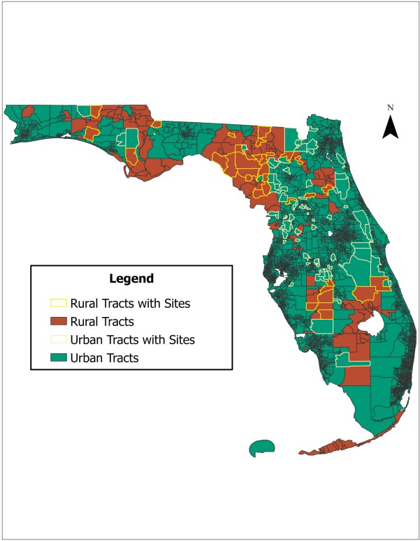

## Publications

```{=html}
<article class="pub">
  <div class="pub-head">
    <p class="kind">Journal article, Journal of Rural Studies, August 2026</p>
    <h3><a href="https://doi.org/10.1016/j.jrurstud.2026.104324">Urban-Rural Transfer and Distributive Environmental Justice in Biosolids Land Application: A Geographic Information Systems (GIS) Analysis of Florida</a></h3>
    <p class="cite">Fernandez, E. (2026). <em>Journal of Rural Studies</em>, 126, 104324. <a href="https://doi.org/10.1016/j.jrurstud.2026.104324">doi.org/10.1016/j.jrurstud.2026.104324</a></p>
  </div>
  <div class="pub-feature">
    <a class="pub-thumb lightbox" href="assets/maps/urban-rural-tracts-sites.jpg" data-gallery="pub-article" title="Rural and urban census tracts, with tracts that contain sites outlined.">
      
    </a>
    <div>
      <p class="hl-title">Highlights</p>
      <ul class="highlights">
        <li>Urban-rural transfer produces environmental inequality.</li>
        <li>Biosolids sites are disproportionately located in rural areas.</li>
        <li>Income is a stronger predictor of exposure than race.</li>
        <li>Results reveal within-rural socioeconomic stratification.</li>
      </ul>
      <p class="links"><a href="https://doi.org/10.1016/j.jrurstud.2026.104324">Read the article</a> <a href="dissertation.html#biosolids-maps">See the maps</a></p>
    </div>
  </div>
</article>
```


```{=html}
<article class="pub">
  <div class="pub-head">
    <p class="kind">Policy report, 1000 Friends of Florida, 2025</p>
    <h3><a href="https://1000fof.org/wp-content/uploads/2025/06/1000-Friends-Final-Biosolids-Report-_updated.pdf">Biosolids in Florida: An Assessment of Management and Impacts</a></h3>
    <p class="cite">Co-author. GIS analysis, spatial assessment, and policy analysis.</p>
  </div>
  <div class="viewer doc">
    <iframe src="https://docs.google.com/viewer?url=https%3A%2F%2F1000fof.org%2Fwp-content%2Fuploads%2F2025%2F06%2F1000-Friends-Final-Biosolids-Report-_updated.pdf&amp;embedded=true" title="Biosolids in Florida report" loading="lazy"></iframe>
  </div>
  <p class="links"><a href="https://1000fof.org/wp-content/uploads/2025/06/1000-Friends-Final-Biosolids-Report-_updated.pdf">Open the report (PDF)</a> <a href="https://1000fof.org/past-webinars/land-application-of-biosolids-in-florida-challenges-opportunities-and-equitable-solutions/">Watch the webinar</a> <a href="dissertation.html#biosolids-in-florida">Project page</a></p>
</article>
```

## Talks

```{=html}
<article class="pub">
  <div class="pub-head">
    <p class="kind">Florida Planning Conference, APA Florida, Daytona Beach, 2025</p>
    <h3>Environmental Justice Concerns in Urban–Rural Planning for Biosolids: A Literature Review</h3>
    <p class="cite">Warren, H. &amp; Fernandez, E. (2025).</p>
  </div>
  <div class="viewer slides">
    <iframe src="https://drive.google.com/file/d/1EOxz4BVsizSJvwPIvk6U-3UVeIFfhsHS/preview" title="Slides: Environmental Justice Concerns in Urban–Rural Planning for Biosolids" loading="lazy" allowfullscreen></iframe>
  </div>
  <p class="links"><a href="https://docs.google.com/presentation/d/1EOxz4BVsizSJvwPIvk6U-3UVeIFfhsHS/present">Open slides full screen</a></p>
</article>

<article class="pub">
  <div class="pub-head">
    <p class="kind">LEEF Mini Conference, Vero Beach, 2024</p>
    <h3>Interdisciplinary Social Sciences in Environmental Education</h3>
    <p class="cite">Fernandez, E. (2024).</p>
  </div>
  <div class="viewer slides">
    <iframe src="https://drive.google.com/file/d/1drX3N20pPSXsY3pCFME32kKAvYoDE--1/preview" title="Slides: Interdisciplinary Social Sciences in Environmental Education" loading="lazy" allowfullscreen></iframe>
  </div>
  <p class="links"><a href="https://docs.google.com/presentation/d/1drX3N20pPSXsY3pCFME32kKAvYoDE--1/present">Open slides full screen</a></p>
</article>
```
